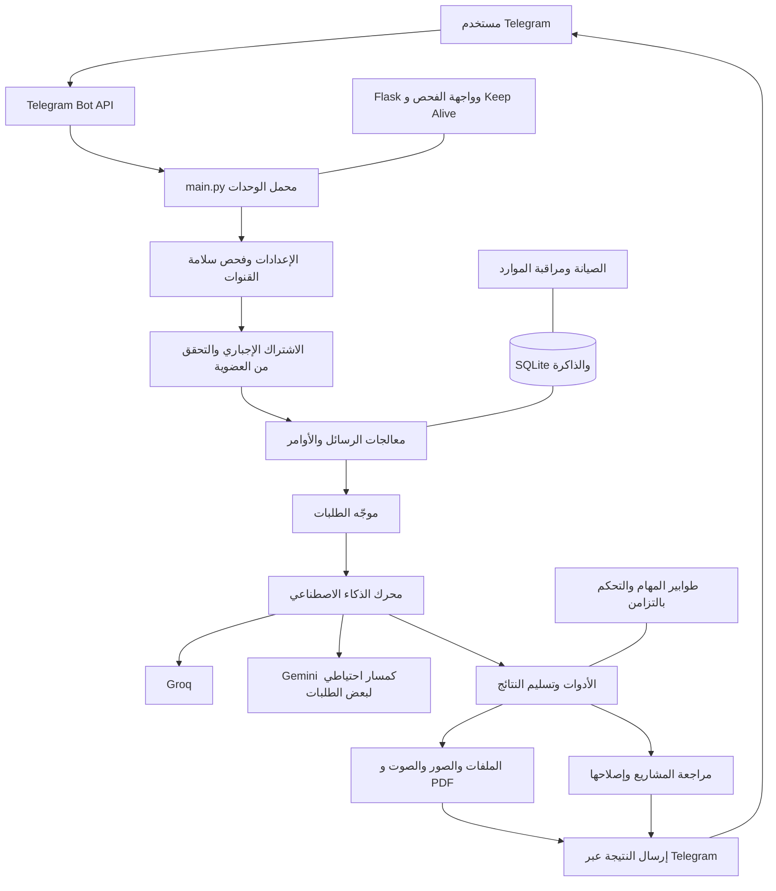

<div align="center">

# ClaudGPT

### بنية برمجية معيارية لمساعد ذكاء اصطناعي يعمل عبر Telegram

**المؤلف الأصلي والمبرمج:** Radlamine  
**المستودع الأصلي:** [github.com/RadLamine/ClaudGPT](https://github.com/RadLamine/ClaudGPT)  
**البوت المرجعي:** [t.me/TatsuLordbot](https://t.me/TatsuLordbot)  
**ترخيص المشروع:** ClaudGPT Community Source License 1.0

</div>

---

## نظرة عامة

ClaudGPT مشروع مساعد ذكي لتيليجرام، صُمّم ليجمع المحادثة، فهم الوسائط، أدوات الإنتاجية، وإدارة المشاريع البرمجية في واجهة واحدة. بُنيت النسخة المعيارية على Python، وقُسّمت إلى وحدات مستقلة حتى يستطيع المطوّر فهم جزء محدد وتعديله دون تحويل الملف الرئيسي إلى كتلة ضخمة يصعب صيانتها.

المشروع متاح للاطلاع والتشغيل والتطوير وفق شروط الترخيص المرفق. يسمح الترخيص بالاستخدام والتعديل وتوزيع النسخ المشتقة، لكنه يشترط الحفاظ على القناتين الأساسيتين وآلية الاشتراك الإجباري ونسبة العمل الأصلي إلى صاحبه. لذلك فهذا **ترخيص مخصص متاح المصدر** وليس ترخيصاً معتمداً من Open Source Initiative؛ يوضح قسم [الحقوق والترخيص](#الحقوق-والترخيص) سبب هذا التمييز.

## ما الذي يقدمه للمستخدم؟

صُمّم ClaudGPT ليكون مساعداً يومياً ومختبراً عملياً للمبرمجين والمستخدمين:

- محادثة باللغة الطبيعية مع ذاكرة محادثة محدودة لكل مستخدم.
- تحليل الصور والملصقات والإطارات الأولى من ملفات GIF والرسوم المتحركة.
- قراءة ملفات PDF واستخراج النصوص، مع مسار OCR للصفحات المصوّرة عند توفر متطلباته، وترجمة المستندات.
- استقبال ملفات النصوص والبرمجة، قراءتها، تعديلها، ثم إرسال النسخة الناتجة كملف.
- مراجعة المشاريع متعددة الملفات وملفات ZIP، مع تحليل ساكن للمشكلات ومحاولة إصلاح الملفات وإرجاعها في حزمة ZIP.
- مسار مراجعة متعدد الوكلاء للمشاريع عند إعداد مفاتيح النماذج اللازمة.
- فهم الرسائل الصوتية والملفات الصوتية والمرئية القصيرة عبر مسار تحويل الكلام إلى نص.
- تحويل النص إلى صوت، وتوليد الصور عند إعداد خدمة الصور ومفاتيحها.
- إزالة خلفية الصور، وقراءة صفحات الويب التي يرسلها المستخدم، والحسابات.
- أوامر للمستخدم وإدارة للمشرف، وتقارير عن الأخطاء، ورسائل جماعية، والتحكم في الطوابير.

قد تتطلب بعض الوظائف مفاتيح API أو برامج نظام خارجية، وقد تتوقف عند عدم إعداد الخدمة المرتبطة بها أو نفاد حصتها. راجع `.env.example` وملف `requirements.txt` قبل النشر.

## الخريطة المعمارية

يوضح المخطط مسار الطلب من تيليجرام إلى طبقة الاشتراك، ثم المعالجة والذكاء الاصطناعي والأدوات، مع الخدمات المساندة التي تعمل بالتوازي.


ولعرض الخريطة كنص قابل للتعديل داخل GitHub:



للتعرف إلى تفاصيل الوحدات ومسؤولية كل منها راجع [docs/ARCHITECTURE.md](docs/ARCHITECTURE.md).

## بنية الملفات

```text
ClaudGPT/
├── main.py
├── bot_modules/
│   ├── 01_configuration.py
│   ├── 02_database.py
│   ├── 03_runtime.py
│   ├── 04_ai_engine.py
│   ├── 05_tools_and_delivery.py
│   ├── 06_chat_routes.py
│   ├── 07_files_and_pdf.py
│   ├── 08_subscriptions_and_commands.py
│   ├── 09_maintenance.py
│   ├── 10_admin.py
│   ├── 11_project_review.py
│   ├── 12_message_handlers.py
│   └── 13_server.py
├── docs/
│   ├── ARCHITECTURE.md
│   ├── CHANNEL_POLICY.md
│   └── architecture-animation.gif
├── .env.example
├── .gitignore
├── CONTRIBUTING.md
├── COPYRIGHT.md
├── LICENSE
├── NOTICE.md
├── PROJECT_INFO.txt
├── render.yaml
└── requirements.txt
```

`main.py` هو نقطة الدخول الوحيدة. يقرأ ملفات `bot_modules` بالترتيب المحدد ويحمّلها في مساحة تنفيذ مشتركة؛ وهذا مقصود لأن الوحدات تتشارك الدوال والحالة وتعريفات معالجات Telegram. لا تشغّل ملفات `bot_modules` منفردة، ولا تغيّر أسماءها أو ترتيبها في `MODULE_ORDER` إلا إذا كنت تعيد تصميم محمّل الوحدات وتختبر جميع نقاط التسجيل.

| الملف | المسؤولية |
|---|---|
| `01_configuration.py` | الإعدادات، مفاتيح الخدمات، النماذج، القنوات الثابتة وفحص سلامتها |
| `02_database.py` | SQLite، سجل المحادثات، المستخدمون، التنظيف الدوري |
| `03_runtime.py` | الطوابير، الأقفال، حدود الاستخدام، حالة المهام والأدوات المساعدة |
| `04_ai_engine.py` | عميل النماذج، تبديل المفاتيح، صياغة الردود واستكمال الرد الطويل |
| `05_tools_and_delivery.py` | أدوات النموذج، توليد الصور، الصوت، الملفات وإرسال النتائج |
| `06_chat_routes.py` | توجيه المحادثة، مسارات Groq وGemini، وتعديل الأكواد |
| `07_files_and_pdf.py` | تنزيل الملفات، الصور، إزالة الخلفية، PDF، OCR، الصوت والخطوط |
| `08_subscriptions_and_commands.py` | الاشتراك الإجباري، أزرار القنوات، أوامر المستخدم والخدمات المرتبطة بها |
| `09_maintenance.py` | الصيانة، إشعارات التنظيف، مراقبة الموارد ووضع الطوارئ |
| `10_admin.py` | لوحة المشرف، إدارة المستخدمين، البلاغات والبث |
| `11_project_review.py` | استقبال المشاريع، تحليلها، مراجعتها وإصلاحها |
| `12_message_handlers.py` | استقبال النصوص والصور والملفات والصوت والفيديو والملصقات |
| `13_server.py` | خادم Flask، تشغيل polling، Keep Alive وتسجيل أوامر البوت |

## أنظمة الحماية الموجودة

### حماية القنوات الأساسية

هناك قناتان أساسيتان مثبتتان في الكود المصدري، ولا تُستبدلان بقيم `.env`:

| القناة | المعرف الثابت |
|---|---|
| قناة تحديثات المشروع | `@dexwep1` |
| قناة منصة المشروع | `@dexwep2` |

تتضمن النسخة الحالية عدة طبقات تحقق:

1. بصمة SHA-256 لقيم معرفي القناتين وروابطيهما؛ يؤدي تغييرها أو حذف تعريفها إلى رفض تحميل الإعدادات.
2. فحص القناتين عند بدء التشغيل عن طريق Telegram؛ إذا لم يستطع البوت الوصول إلى قناة أساسية يتوقف التشغيل.
3. التحقق من عضوية المستخدم قبل تنفيذ مسارات الاستخدام المحمية؛ فشل التحقق لا يمنح إذن الدخول.
4. القنوات الإضافية لا تستبدل القناتين الثابتتين، بل تضاف إليهما فقط.

يجب إضافة البوت مشرفاً في كل قناة مطلوبة حتى يتمكن Telegram من إرجاع حالة العضوية. الحارس البرمجي يردع التعديل العرضي، لكنه لا يستطيع منع شخص يملك صلاحية كتابة كاملة من تعديل جميع ملفات المصدر وإزالة الحارس بنفسه؛ لذلك تبقى حماية صلاحيات المستودع ومراجعة التغييرات ضرورية.

### إضافة قنوات اختيارية

يمكن إضافة قناتين عامتين إضافيتين من متغيرات البيئة التالية:

```env
CHANNEL_UPDATES=@extra_channel_one
CHANNEL_DEXWEP=@extra_channel_two
```

- من دون أي قيمة إضافية: يظهر زرا القناتين الأساسيتين.
- قيمة إضافية واحدة: تظهر ثلاثة أزرار قنوات.
- القيمتان الإضافيتان: تظهر أربعة أزرار قنوات.
- يضاف زر التحقق من الاشتراك بعد أزرار القنوات.
- لا تُحتسب القناة المكررة مرتين.

تقبل القيم اسم قناة عامة مثل `@channelname` أو رابطاً عاماً مثل `https://t.me/channelname`. لا تضع معرفات القناتين الأساسيتين في متغيرات `.env` بغرض استبدالهما؛ فهذه المتغيرات مخصصة للقنوات الإضافية فقط.

التفاصيل التقنية موثقة في [docs/CHANNEL_POLICY.md](docs/CHANNEL_POLICY.md).

### ضوابط تشغيل أخرى

- طوابير منفصلة للخدمات الثقيلة وحدود للتزامن وعدد الطلبات المنتظرة.
- حدود لحجم الملفات والصور وملفات ZIP وعدد صفحات PDF ومقدار النص المقروء.
- حدود معدل للطلبات وبعض الأدوات لتقليل الإساءة والاستهلاك المفاجئ.
- تنظيف دوري لقاعدة البيانات والبيانات القديمة.
- مراقبة موارد الذاكرة والقرص والطوابير مع وضع طوارئ لتقييد العمليات الثقيلة.
- تنقيح مفاتيح API من رسائل الأخطاء قبل إرسالها إلى سجلات الإدارة.
- عدم تضمين أسرار التشغيل في المستودع؛ تحفظ في متغيرات البيئة.

هذه الضوابط لا تغني عن إعدادات آمنة للاستضافة أو النسخ الاحتياطي أو إدارة الأسرار.

## المتطلبات واللغات والتقنيات

**لغة التطبيق الأساسية:** Python.  
**التخزين المحلي:** SQLite وSQL.  
**واجهة الخدمة:** Flask.  
**منصة التفاعل:** Telegram Bot API عبر `pyTelegramBotAPI`.  
**توثيق المشروع:** Markdown وMermaid.  

تتضمن الاعتماديات المستخدمة في المشروع مكتبات مثل `groq`, `python-dotenv`, `requests`, `Pillow`, `imageio-ffmpeg`, `pillow-heif`, `pillow-avif-plugin`, `edge-tts`, `PyMuPDF`, `pypdf`, `reportlab`, `rembg`, `PyYAML` و`pyflakes`. راجع `requirements.txt` للحصول على القائمة المعتمدة في النسخة.

## التثبيت والتشغيل محلياً

### 1. تنزيل المستودع

```bash
git clone https://github.com/RadLamine/ClaudGPT.git
cd ClaudGPT
```

### 2. إنشاء بيئة Python افتراضية

Linux وmacOS:

```bash
python3 -m venv .venv
source .venv/bin/activate
```

Windows PowerShell:

```powershell
py -m venv .venv
.venv\Scripts\Activate.ps1
```

### 3. تثبيت الاعتماديات

```bash
python -m pip install --upgrade pip
pip install -r requirements.txt
```

### 4. تجهيز متغيرات البيئة

أنشئ نسخة محلية من ملف الإعدادات:

```bash
cp .env.example .env
```

في Windows يمكن نسخ الملف يدوياً أو استخدام:

```powershell
Copy-Item .env.example .env
```

املأ القيم الأساسية:

```env
BOT_TOKEN=ضع_توكن_بوت_تيليجرام
ADMIN_ID=123456789
AI_API_KEY=ضع_مفتاح_Groq
GEMINI_API_KEY=ضع_مفتاح_Gemini

# هذان الحقلان اختياريان لقناتين إضافيتين فقط
CHANNEL_UPDATES=
CHANNEL_DEXWEP=
```

احصل على توكن البوت من BotFather، وضع رقم حساب المشرف في `ADMIN_ID`. يلزم إعداد مفتاح Groq للمسارات التي تعتمد عليه؛ أما Gemini فيستخدم لبعض مسارات المحادثة والاحتياط بحسب إعدادات التشغيل. مفاتيح Cloudflare AI مطلوبة عند الرغبة في تشغيل توليد الصور عبر حساب Cloudflare.

لا ترفع `.env` إلى GitHub ولا ترسل محتواه لأحد. لا تضع التوكنات أو المفاتيح في Issues أو لقطات الشاشة أو سجلات عامة.

### 5. إعداد البوت في تيليجرام

1. أضف البوت مشرفاً في `@dexwep1` و`@dexwep2`.
2. أضفه مشرفاً أيضاً في أي قناة إضافية وضعتها في `.env`.
3. تأكد أن البوت يستطيع قراءة حالة الأعضاء في كل قناة.
4. تحقق من صحة `BOT_TOKEN` و`ADMIN_ID` ومفاتيح مزودي الذكاء الاصطناعي.

### 6. تشغيل المشروع

```bash
python main.py
```

افتح البوت في Telegram وأرسل `/start`. لا تشغل أكثر من نسخة polling فعّالة بالتوكن نفسه في الوقت ذاته.

## النشر على الاستضافة

### الخيار الأول: Render — Web Service

هذا هو النوع الملائم لبنية المشروع الحالية؛ لأن `main.py` يشغّل Telegram polling في خيط منفصل ويشغّل Flask على العنوان `0.0.0.0` والمنفذ الذي توفره الاستضافة. اختر **Web Service** وليس **Static Site**. كما أن تشغيله كـ **Background Worker** وحده لا يناسب النسخة الحالية ما دام خادم Flask مطلوباً لفحص HTTP.

1. ارفع المشروع إلى مستودع GitHub تملكه أو لديك صلاحية النشر منه.
2. في Render اختر `New` ثم `Web Service`، واربط المستودع.
3. اختر بيئة Python.
4. ضع أمر البناء:

```bash
pip install -r requirements.txt
```

5. ضع أمر التشغيل:

```bash
python main.py
```

6. أضف متغيرات البيئة في لوحة Render: `BOT_TOKEN`, `ADMIN_ID`, `AI_API_KEY`, `GEMINI_API_KEY`، وأي متغيرات اختيارية تحتاجها.
7. اترك `PORT` للاستضافة لتضبطه، ولا تثبته على رقم محلي.
8. استخدم مسار الفحص `/` إن أردت إعداد Health Check.

يتضمن المستودع ملف `render.yaml` كبداية لإعداد Blueprint. راجع إعدادات الخدمة بعد إنشاءها وتأكد من القيم السرية قبل النشر. راجع [دليل Render الرسمي لنشر Flask](https://render.com/docs/deploy-flask) و[توثيق Web Services](https://render.com/docs/web-services).

**ملاحظة التخزين:** قاعدة البيانات SQLite تُنشأ في مسار `DB_PATH`، والافتراضي `bot_data.db`. على الاستضافات ذات نظام ملفات مؤقت، قد تفقد قاعدة البيانات بعد إعادة إنشاء الحاوية أو النشر. استخدم قرصاً دائماً عندما يكون متاحاً، واضبط `DB_PATH` على مسار القرص، أو جهّز نسخاً احتياطية دورية.

### الخيار الثاني: خادم VPS بنظام Linux

يمنحك VPS تحكماً أكبر بالملفات والخدمة والتخزين الدائم. بعد تثبيت Python وGit وأدوات النظام التي تحتاجها المكتبات، نفّذ خطوات الاستنساخ والبيئة الافتراضية والتثبيت السابقة، ثم أنشئ خدمة `systemd` حتى يعاد تشغيل التطبيق بعد إعادة تشغيل الخادم.

مثال ملف `/etc/systemd/system/claudgpt.service`، مع تعديل المسارات واسم المستخدم بما يناسب خادمك:

```ini
[Unit]
Description=ClaudGPT Telegram AI Bot
After=network-online.target
Wants=network-online.target

[Service]
Type=simple
User=claudgpt
WorkingDirectory=/opt/ClaudGPT
EnvironmentFile=/opt/ClaudGPT/.env
ExecStart=/opt/ClaudGPT/.venv/bin/python /opt/ClaudGPT/main.py
Restart=always
RestartSec=5

[Install]
WantedBy=multi-user.target
```

ثم:

```bash
sudo systemctl daemon-reload
sudo systemctl enable --now claudgpt
sudo systemctl status claudgpt
journalctl -u claudgpt -f
```

احمِ ملف البيئة:

```bash
chmod 600 /opt/ClaudGPT/.env
```

تأكد من أن مجلد المشروع وقاعدة البيانات قابلان للكتابة بواسطة مستخدم الخدمة `claudgpt`، وأن أدوات النظام المطلوبة متوفرة. لا تشغّل نسخة ثانية من البوت بالتوكن نفسه.

## إعدادات مهمة

يحتوي `.env.example` على الحد الأدنى من القيم الأساسية. كما يدعم ملف الإعدادات متغيرات إضافية للتحكم في النماذج والمهل وحدود الملفات والذاكرة والطوابير ومراقبة الموارد والاحتفاظ ببيانات SQLite. لا تضف متغيراً إلى `.env` إلا بعد مراجعة اسمه وسلوكه في `bot_modules/01_configuration.py`.

من المتغيرات الاختيارية التي تظهر في الإعدادات:

| المتغير | الغرض |
|---|---|
| `SITE_URL` | عنوان الخدمة الذي يستخدمه Keep Alive عند تفعيله |
| `BOT_NAME` | الاسم الظاهر للمساعد |
| `AI_API_KEYS` | مجموعة مفاتيح Groq احتياطية مفصولة بفواصل |
| `MODEL_FALLBACKS` | نماذج احتياطية وفق المسار المدعوم |
| `CLOUDFLARE_ACCOUNT_ID` و`CLOUDFLARE_API_TOKEN` | إعداد خدمة توليد الصور |
| `DB_PATH` | مسار قاعدة SQLite |
| `MAX_FILE_WORDS` | الحد الأعلى للكلمات المقروءة من الملف |
| `QUEUE_MAX_WAITING` | الحد الأعلى للمهام المنتظرة |

## الحقوق والترخيص

المؤلف الأصلي للمشروع هو **Radlamine**، والمستودع المرجعي الوحيد لهذا العمل هو:

[https://github.com/RadLamine/ClaudGPT](https://github.com/RadLamine/ClaudGPT)

يسمح الترخيص المخصص بالاستخدام والتشغيل والفحص والتعديل والتطوير وإنشاء نسخ مشتقة وتوزيعها، بما في ذلك الاستخدام التجاري، بشرط الالتزام الكامل بما يلي:

- إبقاء اسم المؤلف الأصلي ونسبة المشروع إليه.
- عدم الادعاء بأنك أنشأت ClaudGPT الأصلي أو أنك صاحبه.
- إبقاء رابط المستودع الأصلي وإشعار الحقوق ونسخة الترخيص ضمن النسخ المعاد توزيعها.
- عدم حذف أو استبدال القناتين `@dexwep1` و`@dexwep2` أو تعطيل الاشتراك الإجباري أو تجاوز التحقق منه.
- عند نشر نسخة معدلة، وضّح أنها نسخة مشتقة، واذكر التعديلات واحتفظ بنسبة الأصل إلى Radlamine.

**توضيح قانوني مهم:** حقوق النشر تحمي التعبير الملموس عن العمل، مثل الكود والوثائق والرسوم الأصلية، لكنها لا تمنح احتكاراً تلقائياً لفكرة مجردة أو أسلوب عمل عام. لذلك لا يمكن لملف README أو ترخيص برمجي أن يمنع كل شخص من تنفيذ فكرة مشابهة بصورة مستقلة. ما ينظمه الترخيص هنا هو استخدام هذا الكود ونسخه وتعديلاته وشروط نسبه والمحافظة على عناصره المحددة. راجع [WIPO: ما الذي يمكن حمايته بحقوق النشر؟](https://www.wipo.int/en/web/copyright/protection).

وبسبب شرط عدم السماح بإزالة القناتين أو تجاوزهما، فهذا الترخيص **ليس ترخيص Open Source معتمداً وفق تعريف OSI**؛ فتعريف OSI يشترط السماح بالأعمال المشتقة وعدم فرض قيود من هذا النوع على الاستخدام والتعديل. الوصف الدقيق هو: **مشروع متاح المصدر بترخيص مجتمعي مخصص**. راجع [Open Source Definition](https://opensource.org/osd).

اقرأ النص الكامل في ملف [`LICENSE`](LICENSE)، وراجع [`COPYRIGHT.md`](COPYRIGHT.md) و[`NOTICE.md`](NOTICE.md) قبل إعادة النشر.

## النسبة والاستشهاد

عند استخدام المشروع أو تقديم نسخة مطوّرة منه، استخدم الصيغة التالية:

> ClaudGPT — المشروع الأصلي بواسطة Radlamine.  
> المستودع الأصلي: https://github.com/RadLamine/ClaudGPT

## روابط المؤلف والمشروع

- **المبرمج والمؤلف الأصلي:** [Radlamine](https://github.com/RadLamine)
- **المستودع الأصلي:** [RadLamine/ClaudGPT](https://github.com/RadLamine/ClaudGPT)
- **البوت المرجعي:** [TatsuLordbot](https://t.me/TatsuLordbot)
- **Facebook:** [صفحة Radlamine](https://www.facebook.com/share/14yUQAJg2Da/)

## المساهمة والتطوير

الاقتراحات والإصلاحات مرحب بها ما دامت تحافظ على شروط الترخيص والقناتين الأساسيتين. قبل إرسال مساهمة، اقرأ [CONTRIBUTING.md](CONTRIBUTING.md). ولإبلاغ مشكلة أمنية، راجع [SECURITY.md](SECURITY.md).

---

<div align="center">

**ClaudGPT**  
Original work by **Radlamine**  
[المستودع الأصلي](https://github.com/RadLamine/ClaudGPT)

</div>
