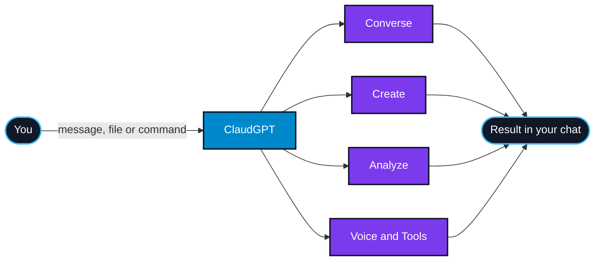

<!-- ═══════════════════════════ HEADER ═══════════════════════════ -->

<a href="https://t.me/TatsuLordbot">
  <picture>
    <source media="(prefers-color-scheme: dark)" srcset="https://readme-typing-svg.demolab.com?font=Fira+Code&weight=600&size=22&duration=3000&pause=1000&color=5CC8FF&center=true&vCenter=true&width=700&height=48&lines=Ask.+Create.+Analyze.+Convert.;Your+AI+assistant%2C+right+inside+Telegram.;Chat%2C+files%2C+voice+and+images+in+one+place.">
    
  </picture>
</a>

 

  

  

<a href="#overview">Overview</a> &nbsp;·&nbsp;
<a href="#capabilities">Capabilities</a> &nbsp;·&nbsp;
<a href="#how-it-works">How It Works</a> &nbsp;·&nbsp;
<a href="#commands">Commands</a> &nbsp;·&nbsp;
<a href="#project-info">Project Info</a> &nbsp;·&nbsp;
<a href="#official-access">Official Access</a> &nbsp;·&nbsp;
<a href="#documentation">Documentation</a> &nbsp;·&nbsp;
<a href="#faq">FAQ</a> &nbsp;·&nbsp;
<a href="#arabic">العربية</a>

 

<!-- ═══════════════════════════ OVERVIEW ═══════════════════════════ -->

## Overview

**ClaudGPT** is an AI-powered assistant available through **Telegram**, designed to help users with information, content processing, creativity, and a variety of digital tasks.

Built using **Python**, ClaudGPT combines multiple AI-powered capabilities within a single conversational interface, making it easier to interact with AI, process different types of content, and access useful tools directly through Telegram.

**In short:** an AI chatbot for Telegram that chats, generates images, analyzes images, PDFs and code projects, converts text to speech, removes image backgrounds, and reads web pages. No app to install: open the bot and send `/start`.

<!-- ═══════════════════════════ CAPABILITIES ═══════════════════════════ -->

## Capabilities

Everything ClaudGPT can do, all inside one conversation.

<table>
  <tr>
    <td width="50%" valign="top">
      <b>AI Conversation</b> 
      Interact with ClaudGPT through natural language, ask questions, explore ideas, and receive AI-generated responses across various topics.
    </td>
    <td width="50%" valign="top">
      <b>Image Generation</b> 
      Generate images from textual descriptions, allowing users to transform their ideas and descriptions into visual content.
    </td>
  </tr>
  <tr>
    <td width="50%" valign="top">
      <b>Image Analysis</b> 
      Upload images and ask the AI to interpret, analyze, describe, and understand their visual content.
    </td>
    <td width="50%" valign="top">
      <b>Document &amp; PDF Analysis</b> 
      Submit documents and PDF files for AI-assisted reading, analysis, understanding, and content extraction.
    </td>
  </tr>
  <tr>
    <td width="50%" valign="top">
      <b>Project &amp; Code Analysis</b> 
      Submit programming projects and compressed archives for AI-assisted examination, understanding project structure, reviewing code, and identifying potential issues.
    </td>
    <td width="50%" valign="top">
      <b>Voice &amp; Audio</b> 
      Interact with voice-related AI capabilities, including processing voice input and working with audio content.
    </td>
  </tr>
  <tr>
    <td width="50%" valign="top">
      <b>Text-to-Speech</b> 
      Convert written text into spoken audio using AI-powered speech generation.
    </td>
    <td width="50%" valign="top">
      <b>Background Removal</b> 
      Remove backgrounds from supported images to help create cleaner visual assets.
    </td>
  </tr>
  <tr>
    <td width="50%" valign="top">
      <b>Web Content Processing</b> 
      Retrieve and analyze accessible webpage content, helping users understand, summarize, and explore information available online.
    </td>
    <td width="50%" valign="top">
      <b>AI Agents</b> 
      Access agent-based capabilities for tasks that require extended processing and multi-step AI interactions.
    </td>
  </tr>
  <tr>
    <td width="50%" valign="top">
      <b>Conversation Management</b> 
      Manage AI conversations through available bot commands, including clearing conversation context and canceling ongoing operations.
    </td>
    <td width="50%" valign="top">
      <b>Ready to try it?</b> 
      Open <a href="https://t.me/TatsuLordbot">ClaudGPT on Telegram</a> and send <code>/start</code>.
    </td>
  </tr>
</table>

<!-- ═══════════════════════════ HOW IT WORKS ═══════════════════════════ -->

## How It Works

ClaudGPT lives entirely inside Telegram. Send a message, a file, or a command, and get the result back in the same chat.

### Getting Started

1. **Open** the official bot: [t.me/TatsuLordbot](https://t.me/TatsuLordbot)
2. **Send** `/start` to begin.
3. **Explore**: chat naturally, send an image or file, or use `/help` to see everything available.

<!-- ═══════════════════════════ COMMANDS ═══════════════════════════ -->

## Telegram Commands

| Command | Description |
|:--|:--|
| `/start` | Start using ClaudGPT. |
| `/help` | View available capabilities and assistance. |
| `/clear` | Clear conversation context. |
| `/cancel` | Cancel an ongoing operation. |
| `/tts` | Convert text into spoken audio. |
| `/rembg` | Remove the background from an image. |
| `/image` | Generate AI images. |
| `/project` | Analyze a programming project or ZIP archive. |
| `/done` | Start reviewing submitted project files. |
| `/agents` | Activate AI agent capabilities. |

> [!TIP]
> Send `/help` inside the bot at any time to see the available capabilities.

<!-- ═══════════════════════════ PROJECT INFO ═══════════════════════════ -->

## Project Information

| Property | Details |
|:--|:--|
| **Project Name** | ClaudGPT |
| **Platform** | Telegram |
| **Programming Language** | Python |
| **Interface** | Telegram Bot |
| **Availability** | Telegram |

<!-- ═══════════════════════════ OFFICIAL ACCESS ═══════════════════════════ -->

## Official Access

<table>
  <tr>
    <td valign="middle">
      <b>Official Telegram Bot</b>  
      <a href="https://t.me/TatsuLordbot">https://t.me/TatsuLordbot</a>  
      
    </td>
    <td align="center" valign="middle">
       
      Scan to open on Telegram
    </td>
  </tr>
</table>

<!-- ═══════════════════════════ DOCUMENTATION ═══════════════════════════ -->

## Documentation

Official policies and project documents. Select a button to open a document.

<table>
  <tr>
    <td width="50%" valign="top">
        
      <b>شروط الاستخدام</b> 
      User rights, acceptable use, prohibited activities, and the possibility of service suspension. 
      حقوق المستخدم، الاستخدام المقبول، المحظورات، وإمكانية إيقاف الخدمة.
    </td>
    <td width="50%" valign="top">
        
      <b>سياسة الخصوصية</b> 
      The data collected, how it is processed, stored, and shared. 
      البيانات التي تجمعها، كيفية معالجتها، تخزينها ومشاركتها.
    </td>
  </tr>
  <tr>
    <td width="50%" valign="top">
        
      <b>إخلاء المسؤولية</b> 
      The project's limits of responsibility, the accuracy of AI answers, and external services. 
      حدود مسؤولية المشروع، دقة إجابات الذكاء الاصطناعي، والخدمات الخارجية.
    </td>
    <td width="50%" valign="top">
        
      <b>الخدمات الخارجية</b> 
      The AI model providers and services in use. 
      توضيح مزودي نماذج الذكاء الاصطناعي والخدمات المستخدمة.
    </td>
  </tr>
  <tr>
    <td width="50%" valign="top">
        
      <b>سياسة الأمان</b> 
      How to report issues and security vulnerabilities. 
      طريقة الإبلاغ عن المشكلات والثغرات الأمنية.
    </td>
    <td width="50%" valign="top">
        
      <b>سجل التحديثات</b> 
      Documentation of features, changes, and fixes. 
      توثيق الميزات والتغييرات والإصلاحات.
    </td>
  </tr>
</table>

<!-- ═══════════════════════════ FAQ ═══════════════════════════ -->

## FAQ

<b>What is ClaudGPT?</b>

 
An AI-powered assistant on Telegram for conversation, image generation and analysis, document and PDF analysis, code and project review, voice, text-to-speech, background removal, and webpage processing.

<b>How do I start?</b>

 
Open <a href="https://t.me/TatsuLordbot">t.me/TatsuLordbot</a> and send <code>/start</code>. Use <code>/help</code> to see everything available.

<b>Can ClaudGPT analyze a whole code project?</b>

 
Yes. Use <code>/project</code> to submit a programming project or ZIP archive, then <code>/done</code> to start the review.

<b>Is the source code available in this repository?</b>

 
No. This repository provides official project information and documentation. It does not serve as a public source-code repository.

<b>Are the AI answers always accurate?</b>

 
No. AI output can be inaccurate or incomplete, so verify important information. See the <a href="DISCLAIMER.md">Disclaimer</a>.

<b>How is my data handled?</b>

 
See the <a href="PRIVACY_POLICY.md">Privacy Policy</a> and <a href="THIRD_PARTY_SERVICES.md">Third-Party Services</a>. Avoid sending passwords, payment details, or highly sensitive information.

<b>How do I report a security issue?</b>

 
Follow the steps in the <a href="SECURITY.md">Security Policy</a>.

<!-- ═══════════════════════════ ARABIC ═══════════════════════════ -->

## العربية

**ClaudGPT** مساعد ذكاء اصطناعي متاح عبر **تيليجرام**، يساعدك في المحادثة، توليد الصور وتحليلها، تحليل ملفات PDF والمستندات، مراجعة المشاريع البرمجية، تحويل النص إلى صوت، إزالة خلفية الصور، وقراءة صفحات الويب، كل ذلك داخل محادثة واحدة.

**للبدء:** افتح البوت الرسمي [t.me/TatsuLordbot](https://t.me/TatsuLordbot) ثم أرسل `/start`. وللاطلاع على كل ما هو متاح أرسل `/help`.

<!-- ═══════════════════════════ SUPPORT ═══════════════════════════ -->

## Support the Project

If ClaudGPT is useful to you, starring the repository and sharing the bot helps more people discover it.

<!--
  Optional, after you know your repository path (OWNER/REPO), add live badges here:

  
  
  
-->

<!-- ═══════════════════════════ ABOUT ═══════════════════════════ -->

## About This Repository

> [!IMPORTANT]
> This repository represents the **official digital identity and documentation** of ClaudGPT.
>
> It is intended to provide official project information and documentation. It does **not** serve as a public source-code repository.

**Topics:** telegram bot · ai assistant · ai chatbot · telegram ai · image generation · image analysis · pdf analysis · code review · text to speech · background removal · ai agents · python

 

<!-- ═══════════════════════════ DISCUSSIONS ═══════════════════════════ -->

## Discussions & Ideas

Have an idea, question, suggestion, or feedback about ClaudGPT? Join the community discussions and help shape future improvements.

Share feature ideas, ask questions, discuss improvements, and contribute constructive feedback.

---

<!-- ═══════════════════════════ FOOTER ═══════════════════════════ -->

<a href="#top">↑ Back to top</a>

<b>ClaudGPT</b>

