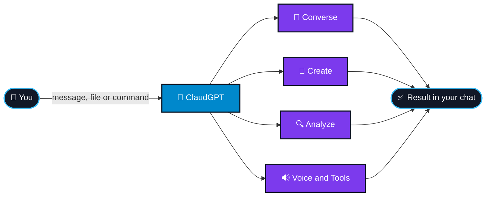

<!-- ═══════════════════════════ HEADER ═══════════════════════════ -->

<a href="https://t.me/TatsuLordbot">
  <picture>
    <source media="(prefers-color-scheme: dark)" srcset="https://readme-typing-svg.demolab.com?font=Fira+Code&weight=600&size=22&duration=3000&pause=1000&color=5CC8FF&center=true&vCenter=true&width=700&height=48&lines=Ask.+Create.+Analyze.+Convert.;Your+AI+assistant%2C+right+inside+Telegram.;Chat%2C+files%2C+voice+and+images+in+one+place.">
    
  </picture>
</a>

 

  

  

<a href="#overview">Overview</a> &nbsp;·&nbsp;
<a href="#capabilities">Capabilities</a> &nbsp;·&nbsp;
<a href="#how-it-works">How It Works</a> &nbsp;·&nbsp;
<a href="#commands">Commands</a> &nbsp;·&nbsp;
<a href="#project-info">Project Info</a> &nbsp;·&nbsp;
<a href="#official-access">Official Access</a>

 

<!-- ═══════════════════════════ OVERVIEW ═══════════════════════════ -->

## ✨ Overview

**ClaudGPT** is an AI-powered assistant available through **Telegram**, designed to help users with information, content processing, creativity, and a variety of digital tasks.

Built using **Python**, ClaudGPT combines multiple AI-powered capabilities within a single conversational interface, making it easier to interact with AI, process different types of content, and access useful tools directly through Telegram.

<!-- ═══════════════════════════ CAPABILITIES ═══════════════════════════ -->

## ⚡ Capabilities

Everything ClaudGPT can do, all inside one conversation.

<table>
  <tr>
    <td width="50%" valign="top">
      <b>💬 AI Conversation</b> 
      Interact with ClaudGPT through natural language, ask questions, explore ideas, and receive AI-generated responses across various topics.
    </td>
    <td width="50%" valign="top">
      <b>🎨 Image Generation</b> 
      Generate images from textual descriptions, allowing users to transform their ideas and descriptions into visual content.
    </td>
  </tr>
  <tr>
    <td width="50%" valign="top">
      <b>👀 Image Analysis</b> 
      Upload images and ask the AI to interpret, analyze, describe, and understand their visual content.
    </td>
    <td width="50%" valign="top">
      <b>📄 Document &amp; PDF Analysis</b> 
      Submit documents and PDF files for AI-assisted reading, analysis, understanding, and content extraction.
    </td>
  </tr>
  <tr>
    <td width="50%" valign="top">
      <b>💻 Project &amp; Code Analysis</b> 
      Submit programming projects and compressed archives for AI-assisted examination, understanding project structure, reviewing code, and identifying potential issues.
    </td>
    <td width="50%" valign="top">
      <b>🎤 Voice &amp; Audio</b> 
      Interact with voice-related AI capabilities, including processing voice input and working with audio content.
    </td>
  </tr>
  <tr>
    <td width="50%" valign="top">
      <b>🔊 Text-to-Speech</b> 
      Convert written text into spoken audio using AI-powered speech generation.
    </td>
    <td width="50%" valign="top">
      <b>🪄 Background Removal</b> 
      Remove backgrounds from supported images to help create cleaner visual assets.
    </td>
  </tr>
  <tr>
    <td width="50%" valign="top">
      <b>🌐 Web Content Processing</b> 
      Retrieve and analyze accessible webpage content, helping users understand, summarize, and explore information available online.
    </td>
    <td width="50%" valign="top">
      <b>🤖 AI Agents</b> 
      Access agent-based capabilities for tasks that require extended processing and multi-step AI interactions.
    </td>
  </tr>
  <tr>
    <td width="50%" valign="top">
      <b>🧹 Conversation Management</b> 
      Manage AI conversations through available bot commands, including clearing conversation context and canceling ongoing operations.
    </td>
    <td width="50%" valign="top">
      <b>🚀 Ready to try it?</b> 
      Open <a href="https://t.me/TatsuLordbot">ClaudGPT on Telegram</a> and send <code>/start</code>.
    </td>
  </tr>
</table>

<!-- ═══════════════════════════ HOW IT WORKS ═══════════════════════════ -->

## 🧭 How It Works

ClaudGPT lives entirely inside Telegram. Send a message, a file, or a command, and get the result back in the same chat.

### 🚀 Getting Started

1. **Open** the official bot: [t.me/TatsuLordbot](https://t.me/TatsuLordbot)
2. **Send** `/start` to begin.
3. **Explore**: chat naturally, send an image or file, or use `/help` to see everything available.

<!-- ═══════════════════════════ COMMANDS ═══════════════════════════ -->

## 🧰 Telegram Commands

| | Command | Description |
|:-:|:--|:--|
| 🚀 | `/start` | Start using ClaudGPT. |
| 🆘 | `/help` | View available capabilities and assistance. |
| 🧹 | `/clear` | Clear conversation context. |
| ⛔ | `/cancel` | Cancel an ongoing operation. |
| 🔊 | `/tts` | Convert text into spoken audio. |
| 🪄 | `/rembg` | Remove the background from an image. |
| 🎨 | `/image` | Generate AI images. |
| 📦 | `/project` | Analyze a programming project or ZIP archive. |
| ✅ | `/done` | Start reviewing submitted project files. |
| 🤖 | `/agents` | Activate AI agent capabilities. |

> [!TIP]
> Send `/help` inside the bot at any time to see the available capabilities.

<!-- ═══════════════════════════ PROJECT INFO ═══════════════════════════ -->

## 🆔 Project Information

| Property | Details |
|:--|:--|
| **Project Name** | ClaudGPT |
| **Platform** | Telegram |
| **Programming Language** | Python |
| **Interface** | Telegram Bot |
| **Availability** | Telegram |

<!-- ═══════════════════════════ OFFICIAL ACCESS ═══════════════════════════ -->

## 🔗 Official Access

<table>
  <tr>
    <td valign="middle">
      <b>Official Telegram Bot</b>  
      <a href="https://t.me/TatsuLordbot">https://t.me/TatsuLordbot</a>  
      
    </td>
    <td align="center" valign="middle">
       
      Scan to open on Telegram
    </td>
  </tr>
</table>

<!-- ═══════════════════════════ ABOUT ═══════════════════════════ -->

## 📌 About This Repository

> [!IMPORTANT]
> This repository represents the **official digital identity and documentation** of ClaudGPT.
>
> It is intended to provide official project information and documentation. It does **not** serve as a public source-code repository.

 

<!-- ═══════════════════════════ FOOTER ═══════════════════════════ -->

<a href="#top">↑ Back to top</a>

<b>ClaudGPT</b>

